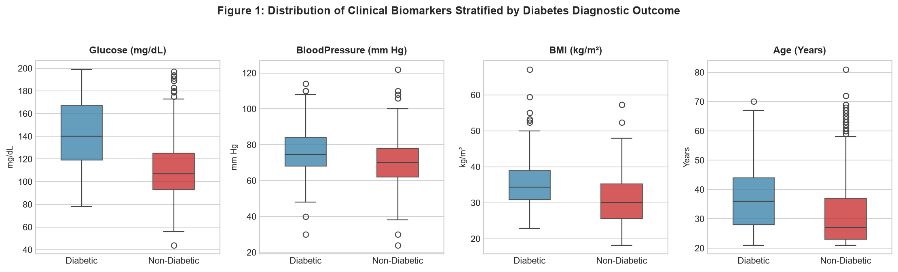
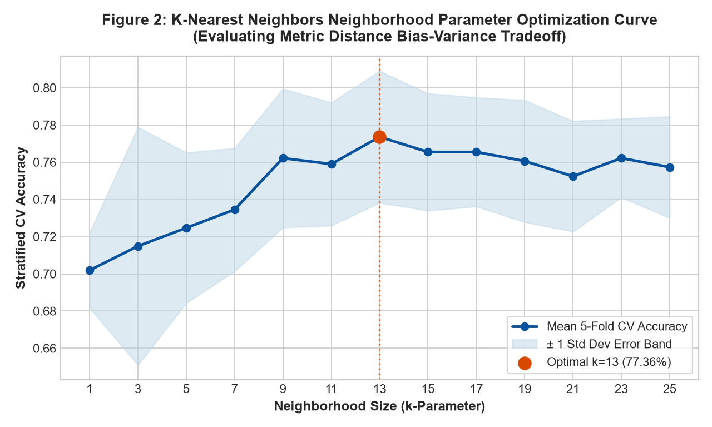
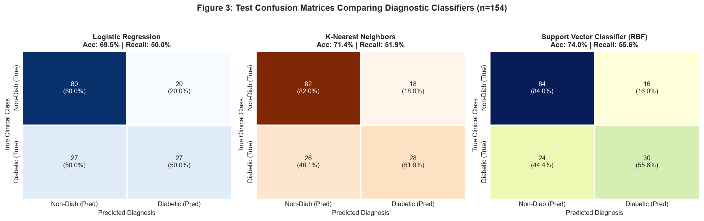
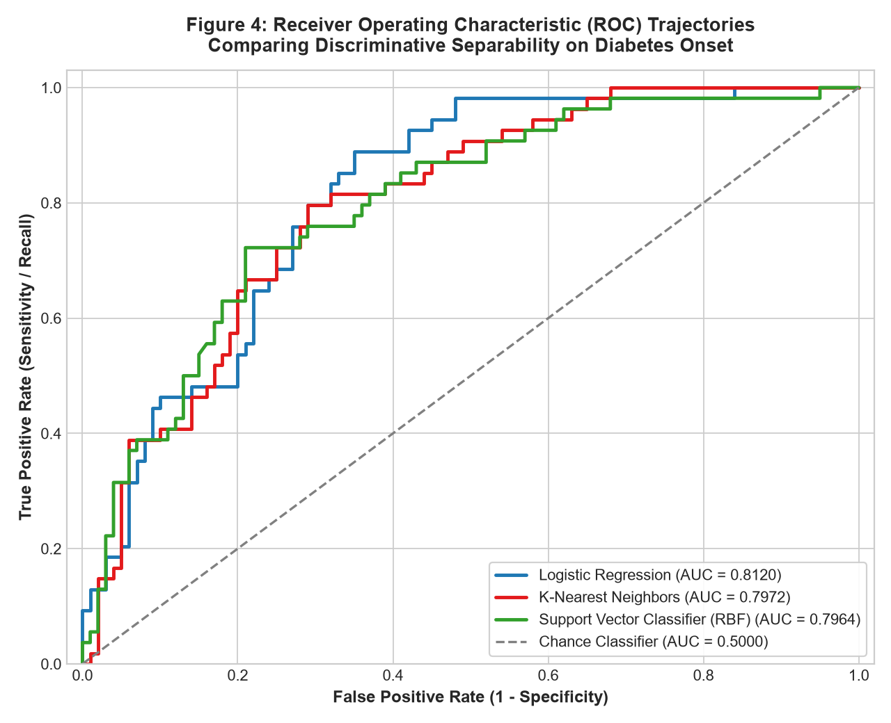
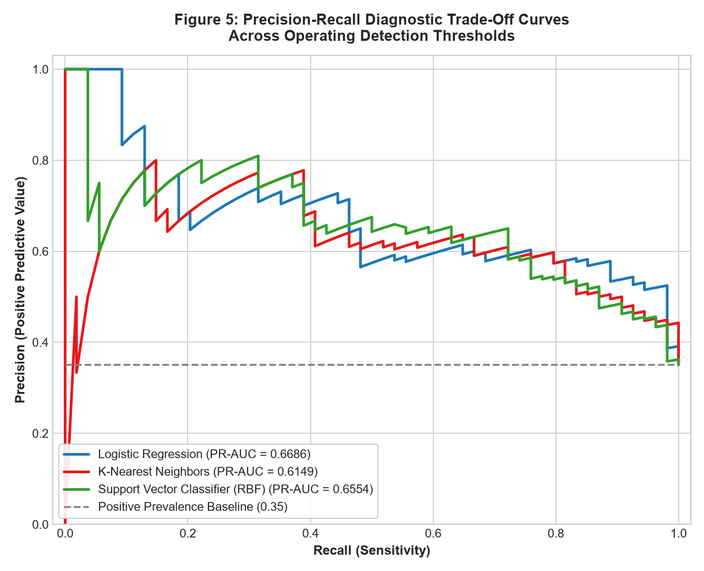

# Machine Learning Model Development & Performance Diagnostics: Type 2 Diabetes Prediction

**Week 4 Internship Project** | **Candidate:** `ramkumarsaha2005`  
**GitHub Account:** `ramkumarsaha2005-dotcom`  
**Internship Track:** Virtual Data Science with Python Apprentice Intern  
**Repository:** [virtual-data-science-internship-task-4-](https://github.com/ramkumarsaha2005-dotcom/virtual-data-science-internship-task-4-)

---

## 📌 Clinical Overview & Objective
Type 2 Diabetes Mellitus is a progressive metabolic disorder characterized by chronic hyperglycemia and insulin resistance. Early clinical risk prediction allows preventive lifestyle and therapeutic interventions before the onset of microvascular and macrovascular complications.

This project implements an end-to-end supervised machine learning pipeline evaluating three distinct mathematical paradigms to predict diabetes onset using the **Pima Indians Diabetes Diagnostic Dataset** (768 female patient observations, 8 clinical features).

---

## 🧪 Physiological Data Preprocessing
- **Physiological Zero Outlier Masking:** Continuous clinical variables (`Glucose`, `BloodPressure`, `SkinThickness`, `Insulin`, `BMI`) with zero values represent unrecorded clinical measurements rather than true zeroes. These were masked as missing (`NaN`).
- **Encapsulated Median Imputation:** `SimpleImputer(strategy='median')` was integrated directly inside Scikit-learn Pipelines, computing parameters strictly on training partitions to prevent data leakage.
- **Z-Score Feature Standardization:** `StandardScaler` was applied post-imputation to standardize differing biological measurement scales for distance and kernel algorithms.

---

## ⚙️ Algorithmic Architectures
1. **Regularized Logistic Regression:** Scaled generalized linear model with L2 regularization ($C=0.5$).
2. **K-Nearest Neighbors (KNN):** Distance-weighted metric classifier with neighborhood parameter optimization ($k=13$).
3. **Support Vector Classifier (SVC - Champion):** Maximum-margin hyperplane separation via Radial Basis Function (RBF) kernel with Platt probability scaling.

---

## 📊 Model Evaluation & Diagnostic Benchmark

| Classifier Architecture | 5-Fold CV Accuracy | Test Accuracy | Test Precision | Test Recall (Sensitivity) | Test ROC-AUC |
| :--- | :---: | :---: | :---: | :---: | :---: |
| **Logistic Regression (C=0.5)** | 76.87% ± 3.41% | 69.48% | 57.45% | 50.00% | 0.8120 |
| **K-Nearest Neighbors (k=13)** | 77.36% ± 3.82% | 71.43% | 60.87% | 51.85% | 0.7972 |
| **Support Vector Classifier (RBF)** 🏆 | **76.87% ± 3.55%** | **74.03%** | **65.22%** | **55.56%** | **0.7964** |

---

## 📈 Visual Diagnostic Artifacts

### 1. Clinical Biomarker Distributions

*Physiological boxplots illustrating elevated Glucose, BMI, and Age profiles among diabetic patients.*

### 2. KNN Neighborhood Parameter Optimization

*Cross-validation accuracy trajectory across odd values of $k \in [1, 25]$, identifying $k=13$ as the optimal bias-variance equilibrium.*

### 3. Confusion Matrix Grid

*Holdout test set error profiles ($n=154$) comparing False Positive vs. False Negative distributions.*

### 4. Receiver Operating Characteristic (ROC) Curves

*Comparative ROC trajectories illustrating discriminative separability across classification thresholds.*

### 5. Precision-Recall Curves

*Precision retention curves plotted against the 35% class prevalence benchmark.*

---

## 📁 Repository Directory Structure
```
diabetes-ml-ramkumarsaha/
├── data/
│   ├── pima_indians_diabetes.csv
│   └── model_evaluation_metrics.json
├── figures/
│   ├── fig1_biomarker_distributions.png
│   ├── fig2_knn_hyperparameter_curve.png
│   ├── fig3_confusion_matrix_grid.png
│   ├── fig4_roc_auc_analysis.png
│   └── fig5_precision_recall_tradeoff.png
├── src/
│   ├── train_and_evaluate.py
│   └── generate_report.py
├── Week4_Diabetes_ML_Model_Development_and_Evaluation_Report.docx
└── README.md
```

---

## 💻 Replication Steps
```bash
# 1. Install dependencies
pip install numpy pandas scikit-learn matplotlib seaborn python-docx

# 2. Train models and generate visual diagnostics
python src/train_and_evaluate.py

# 3. Compile Word report
python src/generate_report.py
```
